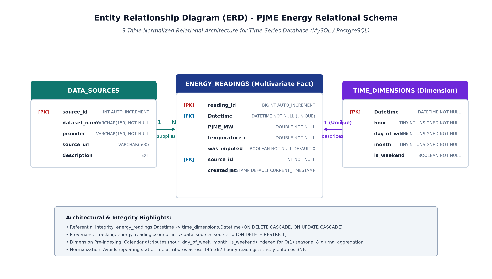
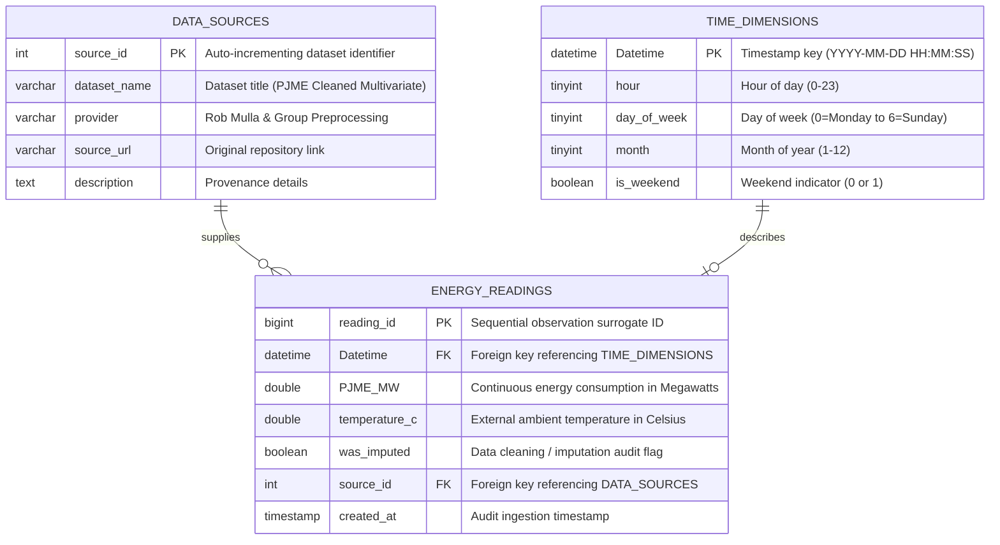

# Entity Relationship Diagram (ERD) & Relational Schema Design

**Author / Member 3:** Laura Karangwa  
**Dataset:** PJM East (PJME) Cleaned Multivariate Electricity Consumption  
**Database System:** MySQL / Relational Engine  

---

## 1. Visual ERD Diagram
The schema follows a normalized Dimensional / Star-Fact architecture tailored for high-volume multivariate time-series analytical workloads.

---

## 2. Structural & Architectural Justification

### A. Third Normal Form (3NF) Compliance
- **Elimination of Transitive Dependencies:** Rather than storing redundant calendar attributes (`hour`, `day_of_week`, `month`, `is_weekend`) directly inside the 145,392 rows of the fact table, they are isolated in `TIME_DIMENSIONS`. Each non-key attribute in `TIME_DIMENSIONS` depends strictly on the primary key `Datetime`.
- **Decoupled Data Provenance:** Ingestion source details (URL, provider, update policies) are stored once in `DATA_SOURCES` (1:N relationship with `ENERGY_READINGS`).

### B. Time-Series Query Optimization
- **Index on Primary Keys:** `TIME_DIMENSIONS.Datetime` is a B-Tree clustered primary key, enabling $O(\log N)$ range scans for date slicing.
- **Multivariate Composite Filtering:** `ENERGY_READINGS` indexes `PJME_MW`, `temperature_c`, and `was_imputed` for fast aggregations and weather correlation studies.
- **Pre-computed Calendar Dimensions:** Grouping by `hour` or `is_weekend` avoids expensive runtime date arithmetic functions (`EXTRACT()`), delivering significant performance gains on large aggregations.

### C. Referential Integrity & Cascade Rules
- **`fk_reading_time`**: `FOREIGN KEY (Datetime) REFERENCES time_dimensions(Datetime) ON UPDATE CASCADE ON DELETE CASCADE`
- **`fk_reading_source`**: `FOREIGN KEY (source_id) REFERENCES data_sources(source_id) ON UPDATE CASCADE ON DELETE RESTRICT`
